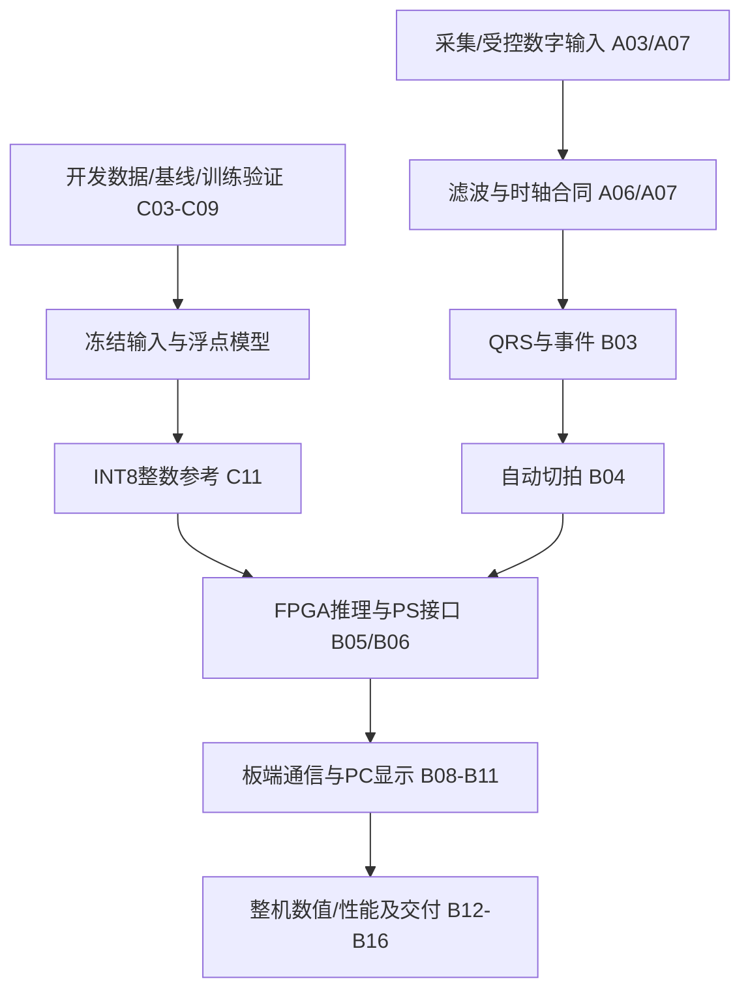

# 项目总体控制计划：协作与风险建议

> 修订：2026-10-18。面向总体/集成负责人，作为现有计划的执行辅助。本文不另立交付目标、验收门槛、人员分工或第二套进度表；唯一任务与勾选入口是[总计划](../report/project_plan.md)及[采集](../report/capture.md)、[主体](../report/system.md)、[模型](../report/model.md)三份专题。

## 1. 当前事实与待确认条件

| 项目 | 可核对状态 | 依据/限制 |
| --- | --- | --- |
| 报名目标 | 采集、滤波/工频抑制、QRS/心率/RR、轻量CNN、INT8、FPGA核心推理、显示和ARM/FPGA对比仍保留 | [总计划](../report/project_plan.md)，本文不取消采集、滤波硬件化或AI部署 |
| 原检测器smoke | 用户返回报告证明合成输入板上通过 | [板上原证据](records/smoke_board_validation_20261017.md)，不是新算法、连续ECG或CNN验收 |
| PC/工程与交接 | PC离线软件检查、共享Vivado文本工程、换路径BD及交接检查已有证据 | 交接审查，不代表实际串口、完整综合流水线或第二电脑已验收 |
| CNN | 严格N/S/V/F仍未合格；训练当前暂停；新6人独立测试未评估 | [训练交接](model_training_handoff.md)，不以本文恢复训练或开启测试 |
| 前端与板卡条件 | AFE/ADC实际模块、板卡修订、采集配置和可用时段须按实物核实 | [采集计划](../report/capture.md)；没有前端或尚未落实时，保留缺项，数字回放只作为阶段验证 |
| 人员与职责 | 可按责任分组交接；成员人数、姓名、实际分工/投入时间以团队确认记录为准 | 不把建议分工写成“已经分工”，不将本文当作向队友派单或发送消息的授权 |

## 2. 关键依赖：先保证接得上



这是接口依赖图，不要求按一条串行路径开发：模型训练不以QRS RTL完成为前置；PC可用明确标注的演示/回放数据先开发；PL可先根据冻结算子合同做模块级数值验证。真实采集与数字回放分别验收，专家位置切拍的分类成绩不能替代自动切拍后的整机结果。

优先核对输入一致性、原始/滤波/事件位置和启动/缺口恢复。具体规则见[采集1.4](../report/capture.md#14-联调前必须补清的验收细节)、[主体2.5](../report/system.md#25-联调行为与最终演示验收细节)、[模型3.6](../report/model.md#36-实际输入与整机延迟的验收细节)，不再复制一套接口定义。

## 3. 建议职责与交接内容

以下是责任范围建议，不预填人名、不假设固定三人或任务已经被接受。每个文件/模块指定唯一主负责人；同一成员可兼任。

| 责任范围 | 交付给下一模块的内容 |
| --- | --- |
| 信息采集 | 模块/资料依据，采样率/导联/单位，原始和滤波输入，时轴/延迟、有效与缺口状态，A类验收证据 |
| 模型开发 | 冻结协议、输入处理、基线对照、逐类/患者结果、浮点/整数权重及黄金向量；失败与独立测试边界 |
| PS/PL实现与显示 | 实际寄存器/缓存/握手、采样与FIFO消费、数值一致性、板端/PC记录、匹配工程及运行证据 |
| 总体与集成 | 接口变更协调、组合版本、最小回归、阻断清单、报告/许可/复现和最终交付；不替代各模块的实际验证 |

有必要集中接口说明时，先检查[寄存器表](register_map.md)、[UART协议](uart_protocol.md)和三份计划，引用已有定义、只补未定部分。现有QRS事件提供位置/RR/序号，不存在已验证的事件置信度字段；不能为了模板完整而编造。CNN分数也不自动等于校准后的疾病概率。

## 4. 检查节点与风险处理

日期只沿用[总计划共同排期](../report/project_plan.md#共同排期与协作)，是内部工作目标，不是已完成事实或自动取消功能的触发器。本文不新增“10月20日必须切换”“10月25日绝对来不及”等期限，也不预测竞赛得分或开发耗时。

| 原计划节点 | 应检查的证据 | 若有阻断如何处理 |
| --- | --- | --- |
| 10月17—18日条件核查 | 前端/板卡时段、输入合同、职责与已有失败诊断 | 明确谁提供什么条件；未确认条件继续标待定，不假定采集目标已取消 |
| 10月19—22日实现检查 | 检测/滤波、PS连续链路、开发模型与INT8/PL接口预算 | 列出实际缺项、原因、可验证的下一尝试和依赖；不靠查看独立测试决定是否继续，不按失败降低质量门槛 |
| 10月23—27日联调目标 | 同源输入、事件/心拍/类别对应，数值和性能证据 | 数字回放与真实采集分别记录；未完成部分不能用旧smoke或离线图片代替 |
| 10月28日—11月1日交付准备 | 匹配镜像/报告/演示、真实协作记录、许可与干净环境复现 | 功能冻结后仅必要缺陷修复，按受影响范围重跑检查，保留失败 |
| 11月2—3日提交准备 | 文件格式/大小、实际公开地址和回执 | 发布、提交、推送或上传均按当前授权，不把准备材料当已经共享 |

当前采用作品截止仍为2026-11-04 18:00（北京时间），沿用总计划已查核来源；本次未重新查询赛事公告。随着日期推进直接读绝对日期，不维护会过期的“今天/还有几天”。

风险处理保持原目标：

- **前端未落实**：数字输入继续用于独立链路开发，A01—A07保留未完成；进一步确认实物/接口和可用时段，不能将人体采集写成已完成或已取消。
- **分类不合格**：执行[模型诊断建议](cnn_analysis_and_suggestions.md)，先检查已有结果和假设，再决定实验；不通过合并S/F、删难例或调低门槛使原任务变成成功。
- **部署资源/时间受阻**：按模型计划3.5比较有依据的轻量结构、算子/缓冲与并行度，量化损失和时延分别评估；PS浮点可作为对照或调试参考，不能替代FPGA推理验收。
- **确需范围调整**：将缺项、证据、影响和候选取舍提交用户/团队确认，另立任务/协议并同步报名和报告口径；本文不批准取消CNN、INT8、PL或采集，也不保证任何简化方案可以得多少分。

## 5. 回归检查与现有入口

建议每次合入影响功能的改动后做对应最小回归，集成节点再做完整组合检查；执行频率/负责人由团队按实际工作约定，不预设已开始每日会议。模型、RTL和板上检查分别留证，不能互相替代。

| 改动范围 | 对应检查 |
| --- | --- |
| 文件/路径/依赖 | sim/check_checkout.py、训练入口静态检查、文档链接；新文件列入清单，忽略规则与实际提交状态分开确认 |
| QRS/滤波/数值算法 | 对应软件测试与受影响完整记录/黄金向量对照；RTL改动加testbench及逐周期比较 |
| 寄存器/FIFO/PS接口 | 原smoke保留独立回归，新增业务另验；RTL接口检查通过不等于板上运行通过 |
| 采集/UART/显示 | 序号、缺口、启动/恢复、波形与事件对齐、原文/CSV和约定负载下连续运行；PC离线演示不能代替真实串口 |
| 模型/预处理/量化 | 冻结的开发验证、逐类/患者与数值对照；独立测试仅在最终冻结方案下开封，不作为回归调参池 |
| 发布组合 | 当前镜像/源码/证据清单哈希、使用步骤和干净环境复现；新候选不自动继承旧验收 |

现有标准库检查入口（这里只说明，不代表本轮执行）：

```powershell
python -B sim/check_checkout.py
python -B sim/check_training_checkout.py
python -B sim/check_baseline.py
python -B sim/check_smoke_release.py
```

Vivado共享工程直接打开vivado/ecg_edge/ecg_edge.xpr；新目录重建可用build/share.tcl，步骤见[vivado说明](../vivado/README.md)。现有RTL验证入口和所需环境见[sim说明](../sim/README.md)，数据/算法入口见[data说明](../data/README.md)。完整综合/实现流水线尚未验收，不引用不存在的run_impl.tcl、shell测试入口或缺参数命令来冒充可复现流程。

## 6. 同步与交付材料建议

需要同步时可采用以下简短格式，会议时间/渠道由成员自行约定：

```text
任务编号/负责人：待实际确认
本次完成与证据：
下一步及所需输入：
阻断、影响与需要决策的事项：
接口/协议/镜像版本变化：
```

完成状态只更新三份专题的任务/子项，达到验收条件才勾选、注明日期和证据；没有消息记录不勾选“已发送给队友”。本文不发送消息，也不代替真实原始协作记录。

报告按B14保留真实问题、结构/接口、实验条件、优化对照和失败/局限；真实提示、回答、纠错和技能包形成依据单独整理，不能用实验摘要冒充原始交互或自动算作已得分。设计报告、技能包、演示时长/格式等以实际竞赛提交要求核对，不在这里编造额外强制页数/得分。

开源及再分发沿用[third_party.md](../third_party.md)与B16，不能用一个泛化的数据许可名称替代不同数据库的实际条款。根README.md和资料索引维持保护，复现说明优先维护已有build/data/sim/board文档与入口；不机械增加根BUILD.md或重复教程。当前Git仍按本会话授权暂停，任何后续发布动作另按授权执行。
