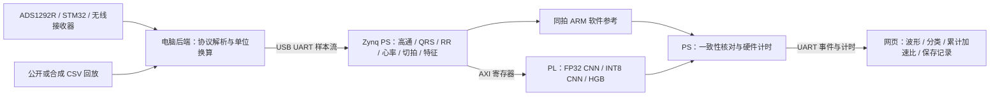

# 心电边缘检测作品：比赛报告写作与演示交接

整理日期：2026-11-03。读者：负责设计报告、演示视频和提交材料的组员。本文根据仓库源码、已保存的工具报告、板测记录，以及队友提供的《2026 AMD 选题指南》3.3 节摘录整理；未独立核验指南版本及官方通知。所有性能数字均给出证据入口，避免把计划、仿真、板测和分类准确率混写。

## 1. 建议采用的作品定位

建议题目：**基于 Zynq-7020 的心电流式分析与可量化验证的 CNN 硬件加速系统**。

可用于报告摘要的表述：

> 本作品以正点原子领航者 V2 的 Zynq-7020 为平台，构建心电采集、传输、心拍检测、边缘分类和可视化系统。PS 端负责连续信号状态管理、预处理、R 峰检测、RR/心率计算与特征准备，PL 端部署 FP32 CNN、W8A8 CNN 和 HGB 分类核心，通过 AXI 寄存器接口完成软硬件协同。系统支持 CNN 整段与流式分析，保留 HGB 整段分析，并在相同心拍上依次运行 ARM 与 FPGA，实时累计计算时间和一致性结果。针对 Zynq-7020 的存储限制，采用全连接输出并行、卷积通道并行及权重 LUTRAM 映射，在不改变原 INT8 数值规则的前提下降低推理延迟和 BRAM 用量。受控 60 秒合成输入的 72 个有效心拍中，优化后的 INT8 ARM 平均耗时 7.695 ms，FPGA 含 AXI 寄存器传输平均耗时 0.854 ms，同精度加速比 9.015 倍。系统作为研究与比赛演示原型，分类质量仍需进一步验证。

摘要中“采集”指系统具备 ADS1292R 接入链路；本文新增硬件验收主要使用合成输入和已采集 CSV 回放，不等于已完成连续无线人体采集的长时验收。

**与早期作品简介的差异必须写清：** 当前模型通路的高通、检测滤波、QRS/R 峰、RR、切拍及特征准备在 ARM。镜像中存在 QRS PL 核，但不能据此宣称当前 CNN 数据通路已完成全部滤波、陷波、QRS 的 PL 加速。当前已经实际加速的是 CNN 全网络及 HGB 树分类核心。比赛摘录允许 RTL、HLS、PS 软件及组合实现，报告应按已实现分工描述。

## 2. 系统组成、接口与功能



| 项目 | 当前实现 |
| --- | --- |
| 板卡/器件 | 正点原子领航者 V2，`xc7z020clg400-2`；底板和核心板修订以实物为准 |
| 工具 | Vivado/Vitis 2026.1，Vitis 裸机路线，未使用 PYNQ/Linux/DPU |
| 时钟 | PL 100 MHz；板上计时器实测配置为 333333343 Hz，不把它当成 ARM 主频 |
| 输入 | 模型通路 500 Hz、mV；标准传输格式 `index,sample,fs,scale`，4096 codes/mV |
| CNN | H27 fold0，FP32 与 W8A8 两种路径，均保留整段/边采边测 |
| HGB | v92 fold0，PL Q40 树推理，保留整段模式；电脑离线 HGB 功能仍在 |
| 性能比较 | 同一 Zynq 的 Cortex-A9 ARM 与 PL，同拍依次运行，独立计时；不是电脑 CPU 对比 |
| 工作灯 | 底板 PL_LED0，H15，LVCMOS33；会话期间约 2 Hz 闪烁，结束后熄灭，已由用户目视确认 |
| 资源显示 | 来自匹配镜像的 Vivado 布局布线报告，是静态硬件资源，不能称“实时占用率” |

| AXI 核 | 基地址 |
| --- | --- |
| QRS | `0x43C00000` |
| HGB | `0x43C10000` |
| FP32 CNN | `0x43C20000` |
| INT8 CNN | `0x43C30000` |
| 工作灯 GPIO | `0x43C40000` |

源码入口：`src/ps/ecg_cnn/`、`src/ps/ecg_hgb/`、`src/hls/ecg_cnn_fast/`、`src/hls/ecg_cnn_int8_fast/`、`src/rtl/ecg_activity_led.sv`。协议见[接口协议](../docs/protocols.md)，当前事实和缺项见[实现报告](report.md)。CNN 和 HGB 同时保留为可选模式，**尚未实现两个模型的融合判决**。

### 输入与状态约定

商家所述偏移二进制 CSV `ecg_raw` 的换算为：

```text
ecg_mV = (ecg_raw - 8388608) * 2420 / (6 * 8388608)
```

这组公式只适用于已确认的对应编码、2.42 V 参考和 PGA=6；已是 mV 的数据不能重复换算，也不能无条件用于其他串口的有符号数据。厂商滤波列标度未确认，不能直接替代原始模型输入。程序不按“典型 1 mV”强行缩放真实幅度。

首选模型输入为未额外数字滤波的 mV，模型 `hp05` 执行 500 Hz、0.5 Hz 一阶因果高通：

```text
a = 500 / (500 + 2*pi*0.5) ≈ 0.99375604660902528
y[0] = 0
y[n] = a * (y[n-1] + x[n] - x[n-1])
```

普通传输分块延续高通、检测、RR、背景及待处理事件状态；断流/重连/重启/增益或导联变化开启新会话。首拍 RR 未知和边界窗口不足保留未分类。网页节律显示滤波与模型输入分开；显示滤波不作为新的模型标定依据。标准 CSV 通过 4096 codes/mV 传输会量化采样值，该标度与 ADC 物理换算不是一回事。

## 3. 模型身份、分类能力及质量边界

### H27 CNN

轻量残差 1D CNN，128 点心拍、原波形与差分双通道，结合 RR 分支及因果形态/背景特征。完整模型约 **25476 个可训练参数、619608 次 Conv/Linear MAC/拍**；导出包还包含 RR 均值/标准差等常量，不能把常量元素数当成训练参数数。融合头输入 269 项，中间全连接 64 单元。架构与训练协议以[模型交接](../docs/cnn_training_handoff.md)及 `model/cnn_fourclass/` 为准。

当前部署权重 SHA256：

```text
16d56a6b1065df35f3e11c4cc285055b421978bd451d5da1b72df8f1744fcfc7
```

固定 fold0 用于工程联调，不按患者切换，不表示该折最优或正式质量定版。训练时 HGB 可作教师，**CNN 推理本身不依赖先运行 HGB**。

| 标签 | 解释 |
| --- | --- |
| N | 按协议合并的正常/传导相关等心拍类别，不等于健康结论 |
| S | 室上性异位心拍 |
| V | 室性异位心拍 |
| F | 融合心拍 |
| UNCLASSIFIED | 边界、RR 未知或输入状态不满足等情况，不能强制归正常 |

HGB 为另一套 N/S/VF 标签；其中 VF 是 V/E/F 合并标签，**不是心室颤动**。展示 CNN 四分类时不要把它与 HGB 三分类一一当成相同标签。

### 可引用的训练交接成绩

以下来自[冻结交接证据](../docs/evidence/cnn_fourclass_handoff_20261102.json)的 `completion.automatic`：开发患者三折 OOF 的自动检测端到端统计，**不是本轮板测、不是统一 fold0 在所有患者上的独立测试，更不是 INT8 临床成绩**。

| 类别 | 参考拍数 | 精确率 P | 召回率 R | F1 |
| --- | ---: | ---: | ---: | ---: |
| N | 125997 | 99.04% | 98.46% | 98.75% |
| S | 1508 | 50.36% | 83.69% | 62.88% |
| V | 16250 | 92.65% | 93.91% | 93.27% |
| F | 161 | 30.00% | 16.77% | 21.51% |

共 143916 个参考心拍；整体 accuracy 97.70%，macro-F1 **69.10%**，N/S/V 平均 F1 **84.97%**。类别极不均衡，不能只用 accuracy 描述效果。证据中还保留专家位置切拍统计，二者不能混用。对应自动检测混淆矩阵如下，最后一列含未正确匹配/未分类处理，按原评估口径解释：

| 真值 → 预测 | N | S | V | F | 第五列 |
| --- | ---: | ---: | ---: | ---: | ---: |
| N | 124053 | 811 | 518 | 11 | 604 |
| S | 183 | 1262 | 56 | 0 | 7 |
| V | 538 | 323 | 15260 | 52 | 77 |
| F | 65 | 1 | 65 | 27 | 3 |

另有额外检测输出 N=411、S=109、V=572、F=0，精确率计算已包含它们；不能仅用上表的已匹配格子重算并忽略额外输出。数据口径：26 个 INCART 开发患者，61 个自动检测缓存记录；MIT 辅助训练拍 30842，不作为外折验证。独立封存患者 8、10、22、23、31、32 未用于上述训练/验证，MIT 201/202 按同一人处理。开发集反复调参存在选择偏差，封存集未验收。S/F 质量仍明显不足，不能写“四类均达到 90%”。

### INT8 的准确性边界

权重与激活 INT8、乘加累计 INT32，残差、偏置和缩放等仍保留 FP32，因此适合称 **W8A8 混合精度实现**，不能称全链路纯整数。量化前后在 72 拍合成测试上有 **5 拍类别变化**，本次优化原样保留；没有专家标注，不能认定哪种正确，也不能声称量化零精度损失。已经证明的是“优化后的 INT8 与原 INT8 实现保持数值/事件一致”，而不是“INT8 与 FP32 完全一致”。

## 4. 性能：可直接用于报告的表格

测量条件：同一板卡、同一 H27 权重，输入为仓库 `model/inference/examples/synthetic500.csv`，500 Hz、60 秒、30000 点，共 73 个事件、72 个有效心拍。以下是每拍平均值，四舍五入展示；各行 ARM 为相应精度软件参考。合成输入用于工程计时和数值验证，不用于分类准确率统计。

| 版本 | ARM 平均 ms/拍 | PL 含寄存器传输 ms/拍 | 同精度 ARM/PL 加速 |
| --- | ---: | ---: | ---: |
| 原 FP32 | 8.247736 | 2.763185 | 2.984865× |
| FP32 全连接四输出并行 | 8.247995 | 1.976009 | 4.174067× |
| 原 INT8（FP32 优化后镜像） | 7.694013 | 1.368123 | 5.623773× |
| INT8 卷积十六输出 + 全连接四输出 | 7.694567 | 0.853556 | **9.014719×** |

优化后的 INT8 单独看 PL 核计算约 **0.795670 ms/拍**，核计算口径相对 ARM 约 **9.670545×**；主结果建议用含 AXI 寄存器传输的 **9.014719×**，更容易与网页一致。两种口径必须标明。

同拍 FP32/INT8 四项计时中，FP32 PL 为 1.976005 ms/拍，INT8 PL 为 0.853556 ms/拍，**FP32 PL / INT8 PL = 2.315027×**。这里同时改变位宽、并行结构及存储实现，不能把全部收益单独归因为 INT8 量化。原 INT8→新 INT8 的 PL 延迟降低 **37.61%**，可以作为同精度硬件结构优化效果。

500 Hz 节拍流式回放：INT8 ARM 平均 7.700178 ms/拍，PL 含传输 0.853722 ms/拍，同精度 **9.019539×**，72 个有效拍、同精度不一致 0；事件在结束前已持续返回。FP32 流式约 **4.175754×**。实时累计比值随每拍原始计时更新，算法稳定时波动小，显示到两位小数可能看起来不变，不能人为添加波动。

以最新整段 INT8 的原始 ticks 计算，72 拍 ARM 总计约 **554.009 ms**，PL 含寄存器传输约 **61.456 ms**。计算方式：

```text
T_arm = arm_ticks / timer_hz
T_pl_call = pl_call_ticks / timer_hz
累计加速比 = ΣT_arm / ΣT_pl_call
```

不能对逐拍加速比直接算术平均作为累计加速。逐拍 ARM/PL 依次运行，会增加验证模式的总负载；这些数据不是同时并行运行的吞吐率测试。

**计时范围：完整神经网络计算 + PL 调用时 AXI 寄存器传输。排除采样等待、ADC、无线、USB_UART、预处理、切拍/特征、softmax 和浏览器显示。** 0.854 ms 是网络调用延迟，不是从电极到屏幕的总延迟；实时心拍判定还需要算法窗口和 RR 状态。网页“含传输”仅指该板内寄存器传输，不能扩大解释为整个系统通信。没有实测功耗，不给出功耗或能效结论。

来源：[FP32 优化摘要](../docs/evidence/cnn_fast_20261103/summary.json)、[INT8 优化摘要](../docs/evidence/cnn_int8_fast_20261103/summary.json)；后者同时保存原始 UART、结果 JSON、独立参考核对、流式记录与源码哈希。

## 5. 资源、时序与优化取舍

均为布局布线后的三核整系统，不是单独 HLS 估算。器件容量 LUT=53200、FF=106400、BRAM36=140、DSP=220。BRAM 按 36 Kb 等效块计，半块表示 BRAM18，不是统计错误。

| 系统阶段 | LUT | FF | BRAM36 等效 | DSP |
| --- | ---: | ---: | ---: | ---: |
| 原三核镜像 | 23386 | 18426 | 121 | 92 |
| FP32 四输出优化 + 原 INT8 + 工作灯 | 24147 | 19789 | 130.5 | 89 |
| 最终 FP32 快核 + INT8 快核 + HGB + 工作灯 | **28626** | **20458** | **122.5** | **105** |
| 最终使用率 | **53.81%** | **19.23%** | **87.50%** | **47.73%** |

最终镜像时钟 **100 MHz**，WNS **+0.102 ns**，WHS **+0.036 ns**，构建记录 DRC 违例数 0。正裕量对应此次约束和实现结果，不代表频率可任意提高。

| 最终核/实例 | LUT | FF | BRAM36 | DSP |
| --- | ---: | ---: | ---: | ---: |
| FP32 CNN | 6667 | 7415 | 66.5 | 35 |
| INT8 CNN | 18837 | 10221 | 12.5 | 70 |
| HGB | 1443 | 608 | 43.5 | 0 |

其余为系统互联、控制、QRS、GPIO 等；核数值的简单求和不一定等于整系统 LUT/FF，层级统计和实现优化可能不同。**BRAM 偏高的重要原因是 FP32、INT8、HGB 三核同时常驻**，其中 FP32 66.5 块、HGB 43.5 块。ARM 程序、电脑模型文件和网页数据不直接占用这些 PL BRAM。前端选 INT8 不会自动卸载另外两个核。

优化决策可写成：

1. FP32 全连接按输出分四路，保持每个输出内部的累加顺序，减少浮点重排误差；独立分层 ROM bank 修正初版共享 ROM 被复制导致的 BRAM 压力。全网络 RTL 周期从 270490 降为 191772。
2. INT8 卷积输出并行 8→16，全连接输出并行 4 路，权重放 LUTRAM，使用尚有余量的 LUT/DSP 换取速度并释放 BRAM。
3. INT8 核 BRAM 20.5→12.5，整系统 130.5→122.5，减少 8 个 BRAM36 等效块；LUT、FF、DSP 增加，100 MHz 仍满足此次时序。INT8 全网络 RTL 周期 131011→79559，降低约 39.27%。
4. 不更换模型、不重训、不修改原 ARM 参考和计时代码；保留数值/类别不一致计数和原始日志，避免通过改变统计口径制造加速。

这组结果体现“资源约束下的软硬件协同”，比单独宣称“量化越小越快”更有依据。原始报告见[资源](../docs/evidence/cnn_int8_fast_20261103/utilization.rpt)、[层级资源](../docs/evidence/cnn_int8_fast_20261103/utilization_hierarchy.rpt)、[时序](../docs/evidence/cnn_int8_fast_20261103/timing.rpt)。

## 6. 如何证明功能正确

| 验证层次 | 已有证据 | 能证明什么 |
| --- | --- | --- |
| FP32 原生对照 | 113 组向量，新旧逐位一致 | 输出并行未改变软件计算规则 |
| FP32 RTL 联合仿真 | 12 组黄金向量，最大 logit 误差约 2.861e-6 | 对这些输入 RTL 符合浮点参考容差 |
| INT8 原生/独立整数参考 | 230 组向量，旧版/快核/Python 逐位一致 | 量化、饱和、累加和缩放语义一致 |
| 历史信号对照 | 合成 72 拍、ADS 已采集数据 12 拍，优化前后 INT8 logits 逐位一致 | 保存的真实/合成输入回归通过 |
| INT8 RTL 联合仿真 | 12 组向量，logit 最大误差 0，79559 周期 | 完整仿真通过；不是仅完成综合 |
| 同精度板测 | 72 有效拍，不一致 0，独立整数参考通过 | 当前板上实现与参考一致 |
| 前后板测事件回归 | 新旧 INT8 共 73 个事件字典完全一致 | 此测试中位置、状态、类别、概率均保留 |
| 网页/会话切换 | 5148 点 ADS CSV；4 种 CNN 模式各 CNN→HGB→CNN，共 12 会话、轮间不复位；8 份 CNN 输出独立复算通过 | 原 FP32/INT8 整段/实时及 HGB 整段仍能连续切换 |
| 实物灯 | 用户确认分析闪烁、结束熄灭 | 已有实际目视验证 |

这里 ADS 数据来自用户已采集文件，经 HTTP/串口回放；不把它写成这轮重新采人体。患者原始 CSV 没有上传。独立参考核对是工程一致性证据，不能代替专家标注准确率。

失败与纠正也可作为大模型协作案例素材，但必须配真实交互记录：

| 观察/失败 | 定位与纠正 | 可复用经验 |
| --- | --- | --- |
| 浮点全连接并行后 BRAM 上升 | 检查综合层级和 ROM 复制，改独立 bank | 并行化先核查存储端口和复制成本 |
| 沙箱内工具读不到许可证 | 保留失败日志，按权限流程运行相同工具 | 区分环境失败与 RTL 功能失败 |
| 两次 XSim 联合仿真主机内存耗尽 | 保留失败，单独重跑 12 向量完整通过；142 个生成 Verilog 与构建 IP 逐字节比对一致 | 不能把综合成功或部分仿真当成全部通过 |
| GPIO 默认参数格式错误 | 修正 Tcl 值的十六进制格式后重建 | 参数类型和生成后 BD 都要核查 |
| Windows 串口错误 5 | 查占用、释放板测/监视器，再实际打开关闭核验 | 一个物理串口同一时刻由一个进程拥有 |

本节是根据工程证据**回顾整理**，不是模型原始回答或原始聊天记录。比赛要求的提示词、模型回答和自我纠错轨迹仍应另行导出、脱敏，不能用这段代替。

## 7. 队友从 Git 获取和复现

最新匹配交付：[优化版板卡目录](../board/cnn_fast_20261103/README.md)。包含 BIT、XSA、ARM ELF/MAP、FSBL、PS 初始化、原始构建收据、routed DCP，以及生成输入映射和完整性清单。不要把旧 `releases/latest` 的 QSPI 文件与新镜像混合；本版仅验收临时 JTAG。

```powershell
git clone --branch main https://github.com/lykzr/ecg-edge-analysis.git
cd ecg-edge-analysis
python -B board/cnn_fast_20261103/check.py
python -B sim/check_checkout.py
python -B sim/check_system_release.py
```

后续安装 Python 网页依赖、构建前端、核对板卡身份、JTAG 加载、启动网页和完整源码重建，执行[统一教程](../docs/download_guide.md)及优化版板卡目录命令。工具路径、COM 口、电缆号使用各自电脑实际值。源码重建入口：

```powershell
& build/rebuild_cnn_triple.ps1 -Python '<模型python.exe>' -Vitis '<Vitis目录>' -Vivado '<Vivado目录>' -Name cnn_fast_rebuild_new -FastWorkLed -Int8Fast -Conv16
```

构建入口不自动下载；`tmp/` 输出不进入 Git。已验证的是本机各阶段构建、实现与板测，组合入口本轮语法检查；尚无陌生电脑全新环境端到端重建验收，不承诺跨主机得到字节完全相同的 BIT。可以先用 Git 原字节镜像完成演示，再独立验证源码重建。

在 Vivado 2026.1 Tcl Console 执行：

```tcl
source {<仓库绝对路径>/board/cnn_fast_20261103/open_routed.tcl}
```

显示真实 Device 布局、系统资源、层级与时序报告；录制时拍到工程/实例名称和器件型号。DCP 是已实现快照，修改设计需按构建脚本重新生成工程。全部 8 份产物及 69 项源输入由 `manifest.json` 校验；原始 BIT SHA256 为：

```text
3c04c9a385fa785dc1ee44524003d2f3bb78e29acfa13aa34ab1c16aedf82ecb
```

## 8. 对照比赛要求：已有与待补

按用户提供的指南摘录组织，不把推荐 PYNQ 写成强制要求。当前裸机路线可说明采用原因：已有成熟 ARM 流式状态机和串口协议，避免迁移操作系统影响既有板级验证，把开发时间用于推理核和数值/性能验证。

| 评测项 | 权重 | 可用材料 | 提交前待补 |
| --- | ---: | --- | --- |
| 创新性与应用价值 | 30 | 连续状态管理、同拍软硬件核对、可观察计时、三核共存与资源取舍 | 补公开相关工作比较与引用；不要宣称首创算法或临床设备 |
| 性能与资源优化 | 20 | 第 4/5 节优化前后表、原始时序资源、同输入计时 | 实录匹配镜像的 Vivado 页面，明确 AXI 计时范围 |
| 功能正确性与完整性 | 20 | 仿真→参考→板测→网页切换证据 | 增加真实接收器现场演示；标明未完成长时/断流异常恢复/分类验收 |
| 大模型协作与技能包 | 15 | 已有 `skill/` 五项通用流程与独立测试、失败分析素材 | **导出真实提示词/回答/纠错轨迹并脱敏**，不要伪造历史对话 |
| 文档与可复现性 | 15 | 源码、参数、依赖、匹配镜像、DCP、构建/加载/校验脚本 | **队友异机全新克隆验收**；保存环境版本、运行结果及差异 |

已有[技能包说明](../skill/README.md)包括文件 SHA/大小校验、冻结容差轨迹比对、下载分层诊断、Vivado 资源/时序核查、公平计时与优化评估。复制 `skill/` 后运行 `python -B -m unittest discover -s tests -p "test_*.py"`；原仓库兼容入口为 `sim/test_skills.py`。2026-11-04 扩展版采用 ASCII 转义 JSON，已修复默认 GBK 解码问题，无需额外设置 PYTHONUTF8。真实报告仍有 1 项输出延迟未约束告警，工具默认阻断；验证范围见 [validation.json](../skill/validation.json)。这些是离线通用工具，未实测 PYNQ，不主张 PYNQ 专项加分；提示词模板不替代原始对话。

目录映射：指南 `src/` 对应仓库 `src/`，`sim/` 对应 `sim/` 和 `docs/evidence/`，`hardware/` 对应 `board/`、`vivado/`，`testdata/` 对应 `data/`、`model/` 的公开/合成输入和参考，`docs/` 设计报告对应 `report/`。文件名保持英文，正文中文；仓库既有 `README.md`、`AGENTS.md`、`SKILL.md` 等约定文件不为整理而批量改名。提交前应按比赛平台对大小写的最终解释复核。

开源自有部分沿用仓库许可，第三方模型、WFDB、AMD IP/BSP/工具生成物按各自条款，见[许可说明](../docs/licenses.md)。不上传厂商资料盘、许可证、账号数据库、工具环境或用户原始生理记录。比赛资格、最高年级分组和具体截止时间由队伍对照官方通知确认。

## 9. 三分钟视频建议：以实际操作为主

| 时间 | 镜头与操作 | 应看到的证据 |
| --- | --- | --- |
| 0:00–0:20 | 实物板卡、ADS 链路、电脑网页 | 板卡型号、供电/连线、输入来源；真人采集按原设备安全条件 |
| 0:20–1:15 | 开始 CNN 边采边测，推荐 INT8 | 波形持续前进、事件和心率、N/S/V/F、累计拍数与 ARM/FPGA 计时；工作灯闪烁 |
| 1:15–1:45 | 正常结束保存，展示结果/累计时间 | 同精度不一致计数、累计加速比；当前量化前后类别变化如实保留 |
| 1:45–2:10 | 切换 FP32 或 HGB 整段分析 | 原功能保留、模型标签与结果来源清楚 |
| 2:10–2:40 | Vivado 匹配 DCP 的 Reports/Device 页面 | 100 MHz、资源使用、正时序裕量；说明静态资源与实时计时的区别 |
| 2:40–3:00 | 展示一条校验命令与 Git 入口 | 产物哈希通过、仓库源码/报告/技能包可获取 |

若用 CSV，画面明确标“回放”；合成输入标“合成信号”，不扮作患者采集。若录现场输入，应先完成独立短时采集预演，避免与串口监视器或后台板测竞争端口。尽量使用一个连续会话展示过程，再切真实资源页面，避免 PPT 占主要时长。

## 10. 交稿时不要遗漏的结论与限制

可以明确声称：已在 Zynq-7020 PL 实际运行 CNN 全网络与 HGB 核；CNN 支持流式与整段；同板 ARM/PL 对照、原始日志、实现资源和可加载产物齐备；最新 INT8 在本受控输入上约 9.015 倍含寄存器传输加速，且 BRAM 相对上个版本减少 8 块。

必须保留限制：S/F 分类质量不足，INT8 存在跨精度类别变化；模型部署固定 fold0 并非正式合格模型；本轮不是独立患者精度验收；没有功耗实测、新版 Flash 冷启动、无线长时和跨电脑完整重建验收；没有实现 CNN/HGB 融合；滤波/QRS/特征在当前模型通路主要由 ARM 负责。把这些写清，会比扩大成果范围更有利于评委核查和队友复现。
