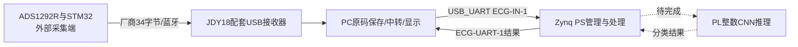
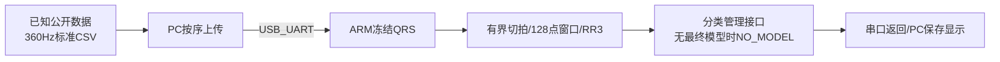

# 系统设计与阶段验证

本文是基于已有源码、协议及验收证据的开发稿。目标包含真实ECG、滤波、QRS、轻量CNN、INT8、FPGA推理及ARM/FPGA比较；当前成果仅覆盖其中已验子链路，不是最终整机报告。

## 要解决的问题与目标链路

ECG数据到达电脑的时刻受无线合包和系统调度影响，不能作为采样时间；波形、检测位置、RR及分类必须共享样本编号。PC负责接收、原码保存、中转和显示；Zynq负责处理，避免把PC的演示或参考结果当成板端结果。协议、确认与错误出口分段定义，保留单位未知、分类未知和上游丢样未知，防止界面给出没有证据的“正常”结果。

以上为已确认目标路线，真实无线及原生500Hz衔接仍待验；不是整条链路已运行的框图。

## 当前已验的运行路径

新冻结QRS运行在ARM，当前没有PL CNN。既有原检测器AXI/FIFO与smoke保留独立回归；不能把原PL检测器成绩继承给新ARM算法，也不能称该路径已经FPGA分类加速。

## 分工与接口

| 部分 | 当前实现 | 仍缺的最终条件 |
| --- | --- | --- |
| 采集接收 | 厂商帧/CSV解码、CH2/CH1区分、原码与预览码分区 | 真实固件、节拍、标定及无线验收 |
| PC与板端 | 双向USB_UART、CRC/序号/确认/停止/错误保存 | 真实双连接/拔插和连续负载 |
| QRS与切拍 | 冻结360Hz C运行时、自动窗口、RR及有界状态 | 原生500Hz/实采；105噪声风险仍有效 |
| 分类 | 输入/编号/模型身份/队列/超时接口；无模型输出未知 | 最终模型、INT8整数参考与分类质量 |
| FPGA | 原硬件链路及独立整数算子准备 | 最终算子覆盖、权重、缓存、传输、整网验证 |

四段格式见[输入合同](../docs/input_contract.md)、[送样协议](../docs/bridge_protocol.md)、[结果协议](../docs/uart_protocol.md)及[分类接口](../docs/classification_protocol.md)。500Hz未知标定码不能直接冒充360Hz的4096单位/mV。

## 已有证据及其范围

| 检查 | 已证事实 | 证据与限制 |
| --- | --- | --- |
| 原smoke | PS→AXI→原检测器→FIFO合成自检通过 | [实板记录](../docs/records/smoke_board_validation_20261017.md)，不是实采/新算法 |
| 冻结C等价 | 42条已知开发记录96931事件、96924完整窗口与参考对齐 | [移植记录](../docs/records/system_port_20261024.md)，不是独立患者测试或42条全板测 |
| ARM数字实板 | 100号30秒、105号120秒前缀及窗口对照；CRC/半帧/停流拒绝和新会话恢复 | 同上，仅数字USB_UART，不是无线、人体、最终CNN |
| PC离线与复现 | 主体通信边界、隐藏Tk、记录及干净源码复制检查 | [离线记录](../docs/records/system_offline_20261024.md)，已有人工反馈仅覆盖离线界面 |

## 设计取舍与风险

保持冻结QRS行为完成C移植，目的是将算法质量问题与移植错误分开；不为了使全记录通过而删除噪声段、按患者特例或放宽门槛。原42条均已查看，41/42只是开发回归；105仍有噪声误检。此前500Hz转换对221号V类漏检，已否决，不放进实际输入路径。

有界缓存、错误停止和新会话恢复优先保证输出可追溯；厂商帧缺源序号/CRC，因此PC本地连续编号不能证明采集端没有丢样。首RR或窗口不足明确无效，无最终模型不能显示正常N。

性能须分开报告计算、上下文等待、通信、排队和显示；当前主机计时仅验证入口，最终ARM/FPGA加速倍数尚无证据。测量口径见[性能说明](../docs/performance.md)。本系统为竞赛原型，分类不能等同疾病诊断，未取得真实输入和整机验收前不作临床结论。

## 当前复现入口

软件离线检查、独立算子和源码重建各有独立命令，说明见[依赖与复现](../docs/dependencies.md)、[整数算子](../docs/int8_ops.md)和[构建说明](../build/README.md)。实验日志、镜像、工具版本和SHA分别保存，待验重建产物不替换已接受latest。最终演示、正式提交、完整许可及原始协作记录仍由主体计划约束，本文不虚构这些完成事实。
